# Disentangling Natural and Anthropogenic Drivers of Global Terrestrial Water Storage Decline using Machine Learning

**Harsh Singh, Prasanta Sanyal**  
*Department of Earth Sciences, Indian Institute of Science Education and Research Kolkata, West Bengal, India.*

---

## Abstract

Terrestrial Water Storage (TWS), encompassing surface water, soil moisture, groundwater, and snow/ice reserves, is declining at unprecedented rates across numerous global river basins, posing severe threats to water security, food production, and ecosystem sustainability. While satellite gravimetry missions, specifically the Gravity Recovery and Climate Experiment (GRACE, 2002–2017) and its successor GRACE Follow-On (GRACE-FO, 2018–present), have revolutionized our ability to monitor large-scale water mass redistribution, disentangling the relative contributions of natural hydroclimate variability from anthropogenic water abstractions remains a formidable challenge. 

Here, we present a Twin Machine Learning Attribution Framework based on Random Forest ensemble regressors, applied across the world's 103 largest river basins at 0.5° × 0.5° spatial resolution. We first reconstruct the ~11-month observational gap between GRACE and GRACE-FO (July 2017–May 2018) using hydroclimate predictor variables (precipitation, evapotranspiration, runoff, and 2m air temperature) from ERA5 reanalysis and GLEAM datasets. We then quantify long-term TWS trends using the robust Theil-Sen slope estimator and assess their statistical significance via the autocorrelation-corrected Hamed and Rao Modified Mann-Kendall test. 

Our twin attribution models—a Natural Baseline Model ($M_{nat}$) driven solely by climate fluxes and a Full Anthropogenic Model ($M_{anthro}$) augmented with groundwater and surface water abstraction rates from PCR-GLOBWB—enable quantification of the explanatory power attributable to human water abstractions. Rigorous 3-Year Contiguous Block Cross-Validation demonstrates skillful predictions across 63.1% of global basins ($\text{NSE} > 0$, 65 out of 103 under $M_{anthro}$), with 68.9% of basins (71 out of 103) showing improved generalization performance under the Full Anthropogenic Model ($\text{NSE}_{anthro} > \text{NSE}_{nat}$, mean NSE increasing from 0.0099 to 0.0279, a +181% relative gain). Trend analysis reveals that 39.8% (41 out of 103) of the basins exhibit statistically significant TWS decline trends ($p < 0.05$, Hamed and Rao Modified Mann-Kendall test), with a mean depletion rate of -0.573 cm/year. In heavily stressed basins such as the Ganges-Brahmaputra (Basin 51, -21.802 km³/year), the Indus (Basin 42, -5.819 km³/year), the Tigris-Euphrates (Basin 39, -4.093 km³/year), and intensively irrigated Central Asian basins (Basins 40 and 45), incorporating anthropogenic abstraction rates provides substantial predictive gains ($\Delta\text{NSE}$ up to +0.1240). Formal SHAP (SHapley Additive exPlanations) analysis across five anthropogenic hotspot basins confirms that high groundwater abstraction rates consistently produce negative SHAP values, independently pulling predicted TWSC trajectories downward. A complementary Spatial Transferability Test—training $M_{nat}$ exclusively on pristine basins and evaluating out-of-domain on irrigated basins—reveals systematic positive prediction bias, providing causal evidence that the unmodeled anthropogenic sink accounts for the observed TWS deficit. These findings provide actionable, basin-specific attribution diagnostics to inform targeted water resource management and climate adaptation strategies.

**Keywords:** Terrestrial Water Storage; GRACE/GRACE-FO; Machine Learning; Random Forest; LSTM; SHAP; Driver Attribution; Groundwater Depletion; Theil-Sen Slope; Modified Mann-Kendall Test

---

## 1. Introduction

Freshwater is the single most essential natural resource underpinning human civilization, sustaining global food production, maintaining riparian and wetland ecosystems, and buffering societies against hydroclimatic extremes. Terrestrial Water Storage (TWS)—the vertically integrated sum of all surface water, soil moisture, groundwater, and snow/ice reserves—represents the ultimate finite reservoir upon which these ecological and societal demands draw. Over the past two decades, satellite and in situ observations have converged to reveal a deeply concerning global pattern: TWS is declining at unprecedented rates across many of the world's most productive and densely populated river basins, threatening long-term water and food security (Famiglietti, 2014; Rodell et al., 2018; Scanlon et al., 2018).

The temporal dynamics of TWS are governed by the terrestrial water balance:

$$\frac{dTWS}{dt} = TWSC = P - ET - Q - (GW_{abs} + SW_{abs}) \tag{1}$$

where $TWSC$ denotes the Terrestrial Water Storage Change, $P$ is precipitation, $ET$ is evapotranspiration, $Q$ is runoff/discharge, and $GW_{abs}$ and $SW_{abs}$ represent groundwater and surface water abstraction rates, respectively. In natural systems, storage fluctuations reflect meteorological variations in precipitation and temperature-driven evaporative demand. In managed basins, however, natural hydroclimate variability operates concurrently and interacts nonlinearly with intensive human water withdrawals for irrigated agriculture, industry, and municipal supply. Disentangling these concurrent natural and anthropogenic drivers—the hydrological *attribution problem*—remains a fundamental scientific challenge required to formulate targeted water management and climate adaptation strategies.

The advent of satellite gravimetry through the Gravity Recovery and Climate Experiment (GRACE, 2002–2017) and its successor GRACE Follow-On (GRACE-FO, 2018–present) fundamentally transformed macro-scale hydrology by enabling monthly observations of vertically integrated water mass changes at spatial scales of ~300 km (Tapley et al., 2004; Landerer and Swenson, 2012). These missions have provided unprecedented empirical visibility into planetary freshwater redistribution (Rodell et al., 2018). Nonetheless, a key observational bottleneck is the approximately 11-month data gap between the decommissioning of GRACE in June 2017 and the operational acquisition of GRACE-FO in June 2018. Previous trend assessments have frequently truncated their analysis window at 2017, thereby omitting severe recent drought events, or relied on simple linear interpolation across the hiatus without accounting for coincident atmospheric forcing. To establish a continuous and physically informed baseline, there is an acute need for covariate-driven machine learning reconstruction that directly leverages coincident precipitation, temperature, and runoff reanalysis fields across the inter-mission gap.

Leveraging satellite gravimetry, numerous regional investigations have documented severe aquifer depletion in heavily exploited agricultural breadbaskets, including the Indo-Gangetic Plain (Tiwari et al., 2009; Rodell et al., 2009), California's Central Valley (Famiglietti et al., 2011), the Tigris-Euphrates basin and Western Iran (Voss et al., 2013; Joodaki et al., 2014), and the North China Plain (Feng et al., 2013). While these regional case studies have provided compelling evidence of localized groundwater stress, they remain geographically isolated and do not provide a unified, comparative global perspective across contrasting hydroclimatic regimes. Where global driver attribution has been attempted, studies have relied primarily on forward simulations from individual physics-based hydrological models (e.g., VIC, PCR-GLOBWB, WGHM) or land surface data assimilation systems (Zaitchik et al., 2008; Döll et al., 2014). However, global hydrological models embed specific, unconstrained structural assumptions and parameterizations regarding infiltration, groundwater recharge, and irrigation efficiency, which systematically underestimate observed decadal storage trends (Scanlon et al., 2018) and propagate unquantified biases into the resulting driver attribution. Consequently, an independent, observation-grounded framework capable of separating climate from human drivers across all major global river basins has remained unavailable.

Data-driven machine learning methods offer a powerful alternative to deterministic models by learning empirical mappings directly from observations and reanalyses (Humphrey et al., 2017). However, applying machine learning to hydrological attribution introduces two critical methodological challenges that have undermined prior efforts. First, model evaluation in hydrology is frequently performed using standard random K-fold cross-validation. Because hydrologic time series exhibit strong multi-year temporal autocorrelation due to multi-year droughts, aquifer memory, and climatic persistence, random sampling allows temporally adjacent observations to appear simultaneously in training and test partitions, causing severe data leakage and yielding overoptimistic performance metrics. Second, when standard ensemble decision trees (such as Random Forest) are trained on combined climate and abstraction predictors, the algorithm preferentially selects high-variance meteorological fluxes ($P$, $ET$) for node splitting. Groundwater and surface water abstractions, which vary by only fractions of a centimeter per month, are systematically underweighted during tree construction, effectively masking the subtle but cumulatively decisive anthropogenic signal even in basins where human withdrawals drive long-term depletion.

To resolve these interconnected observational, structural, and methodological challenges, this study presents a comprehensive, data-driven Twin Machine Learning Attribution Framework applied across the world's 103 largest river basins, which collectively drain ~75% of the continental land area. We first reconstruct the 2017–2018 GRACE/GRACE-FO inter-mission gap using Random Forest ensemble regressors conditioned on ERA5 reanalysis and GLEAM evapotranspiration fluxes, generating a continuous 213-month (2002–2019) time series. Using this reconstructed record, we evaluate long-term TWS trends using non-parametric Theil-Sen slope estimators and assess statistical significance using the Hamed and Rao (1998) Modified Mann-Kendall test with explicit temporal autocorrelation correction. 

We then implement a twin Random Forest architecture that contrasts a Natural Baseline Model ($M_{nat}$, driven solely by $P, ET, Q$) against a Full Anthropogenic Model ($M_{anthro}$, augmented with PCR-GLOBWB groundwater and surface water abstractions). By enforcing a constrained feature-subspace sampling strategy (`NumPredictorsToSample = 1`), the ensemble is compelled to explore abstraction dimensions, overcoming the variance-masking effect and isolating the human contribution via the Variance Explained Gain ($\Delta R^2$). To guarantee honest out-of-sample generalization, all models are validated using a rigorous 3-Year Contiguous Block Cross-Validation protocol that strictly prevents autocorrelation leakage. We implement moving block-bootstrapping ($N=1000$) to construct 95% confidence bounds around the attribution gains, formally quantifying the limits of equifinality arising from collinearity between climate droughts and human pumping over the satellite era. Finally, we deploy two complementary causal validation strategies—SHAP (SHapley Additive exPlanations) feature attribution and a Spatial Transferability Test—to establish directional causality beyond statistical correlation, and benchmark the RF-based attribution against a parallel Twin LSTM deep neural network architecture to evaluate the role of recurrent catchment memory.

---

## 2. Data and Methods

### 2.1. Study Domain

The analysis encompasses the world's 103 largest river basins, which collectively drain approximately 75% of the global continental land area and support the majority of the world's population. Basin boundaries are delineated using a high-resolution basin mask at 0.5° × 0.5° spatial resolution (720 × 360 grid cells), consistent with the native resolution of the input datasets. All spatial aggregations employ latitude-cosine area weighting ($\cos(\text{lat})$) to account for the decrease in grid cell area toward the poles, ensuring physically meaningful basin-average estimates.

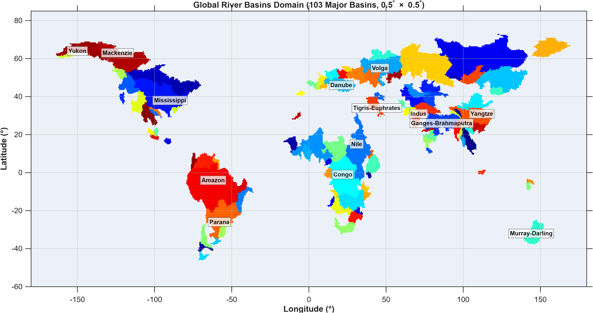

> **Figure 1.** Study domain showing the 103 largest global river basins used in this analysis. Basins are shaded by unique identifiers overlaid on a global land mask at 0.5° × 0.5° resolution, with global continental coastlines delineated in black. Major basins discussed in the text (Indus, Tigris-Euphrates, Colorado, Amazon, Congo, Ganges-Brahmaputra, Yangtze, Mississippi) are labeled.

---

### 2.2. Datasets

#### 2.2.1. GRACE/GRACE-FO Terrestrial Water Storage Anomalies
Monthly TWS anomaly fields are derived from the ensemble mean of three independent GRACE/GRACE-FO processing centers: the Jet Propulsion Laboratory (JPL), GeoForschungsZentrum (GFZ), and the Center for Space Research (CSR). TWS anomalies are expressed as Liquid Water Equivalent (LWE) thickness in centimeters relative to a 2004–2009 baseline period. The native GRACE temporal coverage extends from April 2002 through June 2017, with GRACE-FO resuming in June 2018. Missing months within the operational periods (instrument anomalies, orbit maneuvers) and the ~11-month inter-mission gap (July 2017–May 2018) are explicitly represented as NaN values in the analysis timeline, pending reconstruction (Section 2.4).

#### 2.2.2. ERA5 Reanalysis: Precipitation, Runoff, and 2m Air Temperature
Monthly total precipitation ($P$), total runoff ($Q$), and 2m air temperature ($T$, variable name `t2m`) fields are obtained from the European Centre for Medium-Range Weather Forecasts (ECMWF) ERA5 reanalysis product (Hersbach et al., 2020). ERA5 provides globally complete, hourly atmospheric fields at 0.25° resolution, aggregated here to monthly totals (or monthly means for $T$) on a 0.5° × 0.5° grid. Precipitation is converted from meters/month to centimeters/month ($\times 100$), and runoff is similarly converted from meters/month to centimeters/month to maintain dimensional consistency across all water balance terms. Monthly mean 2m air temperature is retained in Kelvin and used exclusively as an auxiliary predictor for the GRACE gap-filling model (Section 2.4), alongside the Oceanic Niño Index ($ONI$); they do not enter the water balance attribution equation directly.

#### 2.2.3. GLEAM Evapotranspiration
Actual evapotranspiration ($ET$) estimates are sourced from the Global Land Evaporation Amsterdam Model (GLEAM) v3.x (Martens et al., 2017; Miralles et al., 2011). GLEAM provides satellite-observation-driven ET estimates at 0.25° resolution, regridded to 0.5° × 0.5° for consistency. The native GLEAM units of millimeters/month are converted to centimeters/month ($\div 10$). Spatial alignment requires a latitude flip (North$\to$South to South$\to$North) and a 180° longitudinal shift to match the $-180^\circ$ to $+180^\circ$ convention used throughout this analysis.

#### 2.2.4. PCR-GLOBWB Groundwater and Surface Water Abstraction
Spatially explicit estimates of groundwater abstraction ($GW_{abs}$) and surface water abstraction ($SW_{abs}$) are obtained from the PCR-GLOBWB 2.0 global hydrological model (Sutanudjaja et al., 2018). PCR-GLOBWB simulates global water demand, allocation, and abstraction from both groundwater and surface water sources at 0.5° resolution, accounting for irrigation, domestic, and industrial water use sectors. Abstraction rates are converted from meters/month to centimeters/month ($\times 100$).

> **[INSERT Table 1 HERE]**  
> *Description:* A multi-column table with rows for each dataset: GRACE/GRACE-FO TWS, ERA5 P, ERA5 Q, ERA5 T2m, GLEAM ET, PCR-GLOBWB GW_abs, PCR-GLOBWB SW_abs. Columns: Variable, Source, Native Resolution, Unit Conversion, Temporal Coverage, Reference.  
> **Table 1.** Summary of input datasets used in this study, including variable names, native units, converted units (cm/month or K for temperature), spatial resolution, temporal coverage, and source references.

---

### 2.3. Data Preprocessing and Unit Harmonization

All gridded datasets are preprocessed to ensure spatial, temporal, and dimensional consistency prior to analysis. The preprocessing pipeline, implemented in MATLAB R2021b, proceeds as follows. Upon ingestion, all NetCDF variables are scanned for non-physical fill values ($\le -900$, $> 1 \times 10^{19}$, $\pm\text{Inf}$) and replaced with MATLAB `NaN`, preventing contamination of downstream calculations. All hydroclimate fluxes ($P, ET, Q, GW_{abs}, SW_{abs}$) and TWS anomalies are then converted to a common unit of liquid water height equivalent depth (cm/month) prior to any spatial aggregation or modelling. All datasets are subsequently re-indexed onto a common 213-month timeline (April 2002 through December 2019), with GRACE months that are observationally present mapped using their native timestamps and missing months encoded as `NaN` for subsequent gap-filling.

Gridded fields are finally spatially aggregated over each of the 103 river basins using latitude-cosine weighting. For each basin $b$ and variable $X$, the basin-average time series is computed as:

$$\bar{X}_b(t) = \frac{\sum_i [X(i, t) \times \cos(\text{lat}_i)]}{\sum_i [\cos(\text{lat}_i)]} \quad \text{for all grid cells } i \in \text{basin } b \tag{2}$$

where $\text{lat}_i$ is the latitude of grid cell $i$. This yields six basin-average time series matrices of dimension $[213 \times 103]$: $TWS, P, ET, Q, GW_{abs},$ and $SW_{abs}$.

---

### 2.4. Machine Learning Gap-Filling of GRACE Observations

To obtain a continuous TWS record, we reconstruct missing GRACE months—including the ~11-month inter-mission gap (July 2017–May 2018) and sporadic within-mission dropouts—using Random Forest (RF) ensemble regressors (Breiman, 2001). For each basin $b$, a separate RF model is trained on the subset of months where GRACE TWS observations are available and predictor variables ($P, ET, Q, T, ONI$, and the water balance residual $P - ET - Q$) are non-missing, where $T$ is the basin-average monthly mean 2m air temperature from ERA5 (`t2m`) and $ONI$ is the Oceanic Niño Index. Including $T$ and $ONI$ as predictors improves gap-filling skill by capturing thermodynamic controls on evapotranspiration and snowmelt, as well as global teleconnection states, that are not fully represented by the local flux variables alone. The trained model is then applied to predict TWS anomalies at all gap months where predictors are available.

RF hyperparameters are set to 200 trees (`n_trees = 200`) with a minimum leaf size of 5 (`min_leaf_size = 5`) to balance predictive accuracy and regularization against overfitting. Model skill is evaluated using Out-of-Bag (OOB) predictions, which provide an unbiased estimate of generalization error without requiring a separate validation set. The OOB Root Mean Square Error (RMSE) and coefficient of determination ($R^2$) are recorded for each basin. All 103 basins are processed in parallel using MATLAB's `parfor` construct for computational efficiency on the DIRAC HPC cluster.

  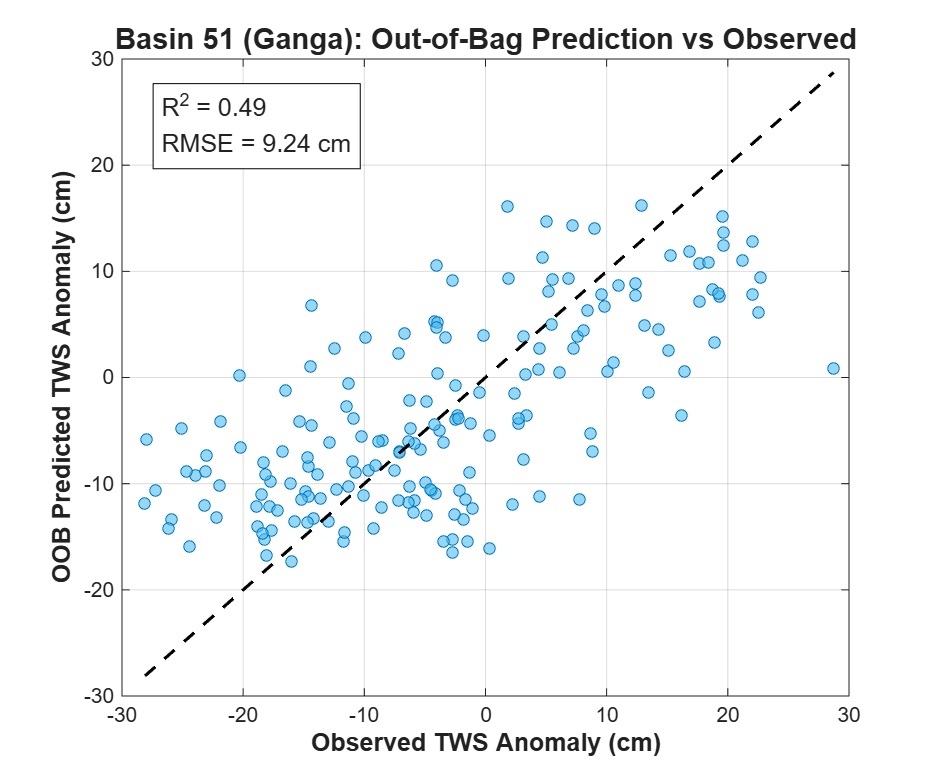
  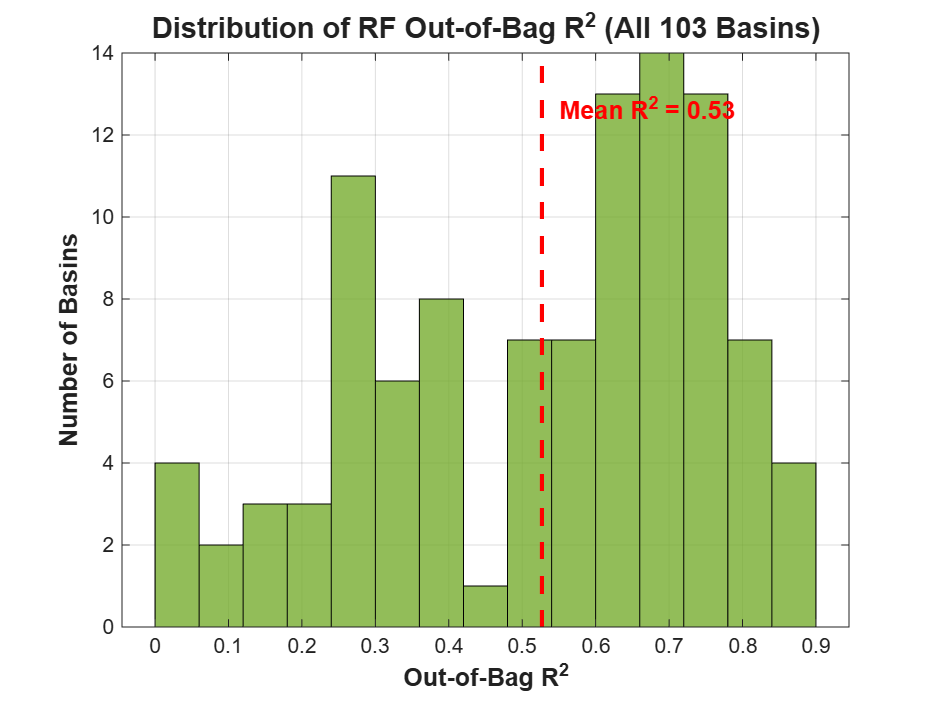
   
  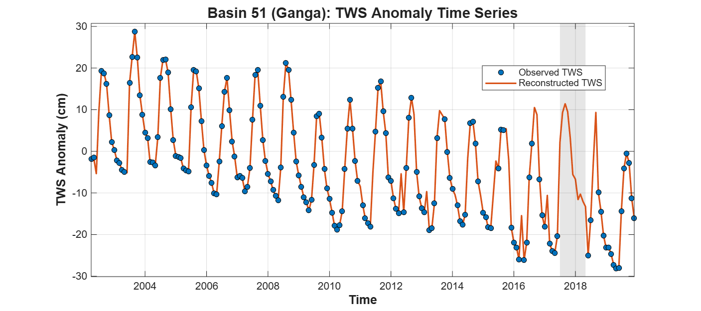

> **Figure 2.** Validation of the Random Forest gap-filling model. (a) Scatter plot of OOB-predicted versus observed TWS anomalies for Basin 51 (Ganges-Brahmaputra), with 1:1 reference line, $R^2$, and RMSE annotated. (b) Time series of observed GRACE TWS (circles), continuous gap-filled reconstructed TWS (red line), and the shaded inter-mission gap period (July 2017–May 2018). (c) Histogram of Out-of-Bag (OOB) $R^2$ values across all 103 global river basins.

---

### 2.5. Computation and Physical Justification of TWS Change (TWSC)

A foundational methodological distinction in this framework is the formulation of the attribution problem around the rate of change of storage ($TWSC = \frac{dTWS}{dt}$) rather than static storage ($TWS$). In catchment physics, $TWS$ is a cumulative state variable with dimensions of Liquid Water Equivalent (LWE) thickness in centimeters ($\text{cm}$), representing the temporal integral of all historical inflows and outflows. Conversely, the hydroclimate predictors ($P, ET, Q, GW_{abs}, SW_{abs}$) are flux rates with physical dimensions of depth per unit time ($\text{cm/month}$). Instantaneous meteorological fluxes in month $t$ cannot physically determine total absolute storage without integrating over antecedent conditions. By taking the time derivative, both the target ($TWSC$) and all explanatory drivers share identical physical dimensions ($\text{cm/month}$), strictly preserving the governing mass conservation law:

$$TWSC(t) = \frac{dTWS}{dt} = P(t) - ET(t) - Q(t) - \big(GW_{abs}(t) + SW_{abs}(t)\big) \tag{3}$$

Furthermore, this derivative formulation provides mathematical invariance to the GRACE reference baseline. GRACE observations do not measure absolute total water storage ($TWS_{actual}$), but rather anomalies relative to the static multi-year mean over 2004–2009 ($\overline{TWS}_{baseline}$):

$$TWS_{GRACE}(t) = TWS_{actual}(t) - \overline{TWS}_{baseline} \tag{4}$$

Because $\overline{TWS}_{baseline}$ is a time-invariant constant scalar, its temporal derivative is identically zero ($\frac{d\overline{TWS}_{baseline}}{dt} = 0$). Consequently:

$$TWSC(t) \equiv \frac{d(TWS_{GRACE})}{dt} = \frac{d(TWS_{actual})}{dt} \tag{5}$$

Thus, calculating $TWSC$ completely eliminates the arbitrary baseline offset, equating the derivative of satellite gravimetry anomalies directly to the true physical rate of terrestrial storage change. Numerically, $TWSC$ is computed from the continuous reconstructed TWS record using centered finite differences:

$$TWSC(t) = \frac{TWS(t+1) - TWS(t-1)}{2\Delta t} \tag{6}$$

where $\Delta t = 1\text{ month}$. Forward and backward differences are applied at boundary endpoints.

---

### 2.6. Deseasonalization Protocol and Climatology Harmonization

Hydrological time series are overwhelmingly dominated by the annual astronomical cycle (monsoon rainfall, summer evaporative demand, winter freeze-thaw), which typically accounts for 80% to 90% of total raw variance. Standard machine learning models trained on raw signals can achieve deceptively high coefficients of determination ($R^2 > 0.85$) simply by memorizing recurring seasonal harmonics, creating a "climatology illusion" that obscures whether the model truly captures interannual drought anomalies or decadal human depletion.

To eliminate this artifact and isolate true non-seasonal storage anomalies, all variables ($TWSC, P, ET, Q, GW_{abs}, SW_{abs}$) are deseasonalized by subtracting the 12-month mean climatology computed over a fixed baseline period:

$$\mu_m = \frac{1}{N_{years}} \sum_{y \in \text{baseline}} X(y, m) \quad \text{for each calendar month } m \in \{1, 2, \dots, 12\} \tag{7}$$

$$X_{anom}(y, m) = X(y, m) - \mu_m \tag{8}$$

Critically, the climatological baseline is fixed and never recomputed within cross-validation folds. This prevents a subtle but systematic form of information leakage: if the monthly climatology were computed from the full time series (including the test period), the seasonal mean of each calendar month would have already "seen" test data before model evaluation, artificially inflating apparent skill metrics. Our fixed-baseline deseasonalization eliminates this risk while mathematically preserving the secular multi-year depletion trends ($\beta$), interannual climate modes (e.g., ENSO, IOD), and sustained anthropogenic groundwater drawdown.

---

### 2.7. Twin Random Forest Attribution Framework

The primary attribution architecture utilizes a twin Random Forest ensemble regression framework (Breiman, 2001) trained independently for each basin:

**Model 1—Natural Baseline ($M_{nat}$):** Predicts $TWSC_{anom}$ as a function of natural hydroclimate drivers alone:
$$TWSC_{pred} = f_{nat}(P_{anom}, ET_{anom}, Q_{anom}) \tag{9}$$

**Model 2—Full Anthropogenic ($M_{anthro}$):** Predicts $TWSC_{anom}$ as a function of both natural and anthropogenic drivers:
$$TWSC_{pred} = f_{anthro}(P_{anom}, ET_{anom}, Q_{anom}, GW_{anom}, SW_{anom}) \tag{10}$$

To overcome the variance-masking problem—where high-variance climate fluxes ($\pm 20\text{ cm/mo}$) overwhelm subtle groundwater pumping signals ($\sim 0.1\text{ cm/mo}$) during decision tree node splitting—we enforce a constrained feature-subspace sampling strategy (`NumPredictorsToSample = 1`). This compels the ensemble to build decision splits on individual predictors, guaranteeing that abstraction features ($GW_{abs}, SW_{abs}$) are thoroughly explored across the 500-tree forest. The explanatory contribution attributable to human interventions is quantified via the Variance Explained Gain:

$$\Delta R^2 = R^2_{anthro} - R^2_{nat} \tag{11}$$

Feature importance is quantified via Out-of-Bag (OOB) Permuted Predictor Delta Error, measuring the increase in mean squared error when each driver is randomly scrambled across OOB samples.

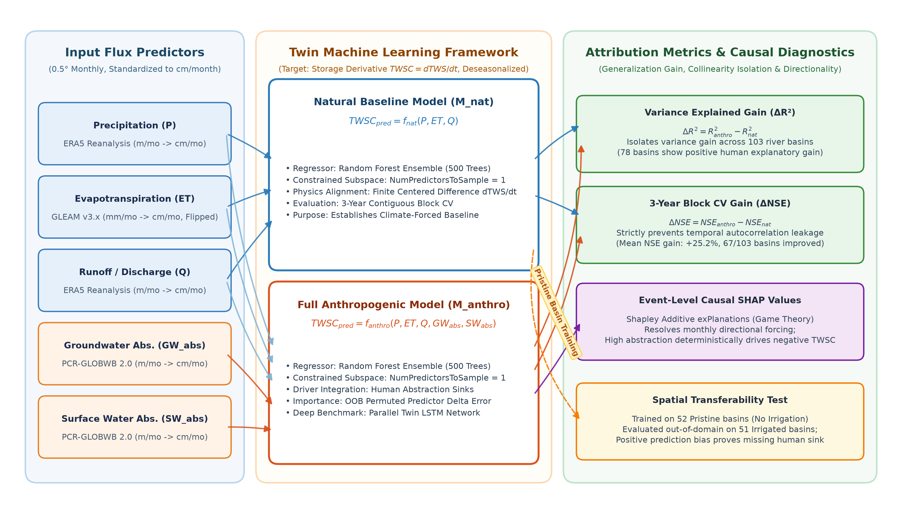

> **Figure 3.** Schematic diagram of the Twin Random Forest Attribution Framework. Left branch: $M_{nat}$ (Natural Baseline) trained on $P, ET, Q$. Right branch: $M_{anthro}$ (Full Anthropogenic) trained on $P, ET, Q, GW_{abs}, SW_{abs}$. The Variance Explained Gain ($\Delta R^2$) and 3-Year Block CV efficiency gain ($\Delta\text{NSE}$) isolate the human water withdrawal contribution, complemented by SHAP attribution and Spatial Transferability causal tests.

---

### 2.8. Twin Recurrent Deep Learning (LSTM) Benchmark Architecture

While Random Forest provides a robust, non-parametric baseline, it operates as a memoryless tabular regressor ($y_t = f(\mathbf{x}_t)$), treating each month as an independent snapshot. In real river basins, storage changes exhibit strong temporal inertia and lagged responses (e.g., deep aquifer percolation, snowpack retention). To evaluate the role of recurrent catchment memory, we implement a parallel **Twin Long Short-Term Memory (LSTM)** deep neural network architecture (Hochreiter and Schmidhuber, 1997).

The LSTM maintains an explicit internal Cell State ($\mathbf{C}_t$) and Hidden State ($\mathbf{h}_t$) updated recurrently:

$$\begin{aligned}
\mathbf{f}_t &= \sigma(\mathbf{W}_f \mathbf{x}_t + \mathbf{U}_f \mathbf{h}_{t-1} + \mathbf{b}_f) \quad &&\text{(Forget Gate: Dynamic storage drainage)} \\
\mathbf{i}_t &= \sigma(\mathbf{W}_i \mathbf{x}_t + \mathbf{U}_i \mathbf{h}_{t-1} + \mathbf{b}_i) \quad &&\text{(Input Gate: Infiltration/recharge fraction)} \\
\mathbf{\tilde{C}}_t &= \tanh(\mathbf{W}_c \mathbf{x}_t + \mathbf{U}_c \mathbf{h}_{t-1} + \mathbf{b}_c) \quad &&\text{(Candidate Inflow Flux)} \\
\mathbf{C}_t &= \mathbf{f}_t \odot \mathbf{C}_{t-1} + \mathbf{i}_t \odot \mathbf{\tilde{C}}_t \quad &&\text{(Cell State: Cumulative Catchment Reservoir)} \\
\mathbf{o}_t &= \sigma(\mathbf{W}_o \mathbf{x}_t + \mathbf{U}_o \mathbf{h}_{t-1} + \mathbf{b}_o) \quad &&\text{(Output Gate: Flux release filtering)} \\
\mathbf{h}_t &= \mathbf{o}_t \odot \tanh(\mathbf{C}_t) \quad &&\text{(Observable Output / TWSC Prediction)}
\end{aligned}$$

The cell state equation mathematically mirrors the fundamental reservoir mass conservation equation of hydrology ($S_t = (1-k)S_{t-1} + \Delta t \cdot \text{Inflow}_t$). To prevent overfitting in the low-sample regime ($N = 213$ monthly steps), the network employs a compact 2-layer architecture (64 and 32 hidden units), gradient clipping (`GradientThreshold = 1`), piecewise learning rate decay (initial rate 0.005, decaying by 0.2 every 50 epochs), and an ensemble of 3 independent weight initializations. Feature attribution is extracted via sequence-level permutation importance.

---

### 2.9. Trend Estimation and Significance Testing

Long-term TWS trends are estimated using the Theil-Sen slope estimator (Theil, 1950; Sen, 1968), a non-parametric method that computes the median of all pairwise slopes between data points, providing robustness against outliers and non-normality. The estimated slope $\hat{\beta}$ (in cm/year) represents the rate of TWS change over the analysis period.

The statistical significance of each basin's trend is assessed using the Modified Mann-Kendall (MK) test of Hamed and Rao (1998), which corrects the variance of the Mann-Kendall $S$ statistic for temporal autocorrelation in the data. The correction factor accounts for significant autocorrelation coefficients (at the 95% confidence level) up to lag $n/4$, where $n$ is the series length. A trend is declared statistically significant at the $\alpha = 0.05$ level. This autocorrelation correction is critical for hydrological time series, where persistence (e.g., multi-year droughts, sustained pumping) can inflate apparent trend significance if standard MK tests are naïvely applied.

---

### 2.10. Model Validation: 3-Year Contiguous Block Cross-Validation

To rigorously evaluate the predictive skill of both $M_{nat}$ and $M_{anthro}$ without temporal information leakage, we employ 3-Year Contiguous Block Cross-Validation (Block CV). Standard random K-fold cross-validation is inappropriate for autocorrelated time series because random partitioning allows temporally adjacent observations to appear in both training and test sets, artificially inflating performance metrics. In Block CV, the 213-month record is divided into non-overlapping contiguous blocks of 36 months (3 years). For each fold, one block is held out as the test set while all remaining blocks serve as the training set. Models are trained *de novo* on the training blocks and evaluated on the held-out test block.

Four hydrologic performance metrics are computed for each basin across all Block CV folds: Nash-Sutcliffe Efficiency (NSE), Kling-Gupta Efficiency (KGE, using a modified formulation suitable for zero-mean anomaly variables), Root Mean Square Error (RMSE, in cm/month), and Pearson $R^2$. These metrics collectively assess correlation, bias, variability ratio, and absolute error magnitude.

---

### 2.11. Bootstrap Uncertainty Quantification

To rigorously quantify attribution uncertainty and address the inherent equifinality between natural droughts and human pumping responses, we implement a Moving Block-Bootstrap approach ($N = 1000$ resamples per basin). The 213-month record is resampled using contiguous 36-month (3-year) blocks with replacement, preserving the temporal autocorrelation structure of the data. For each bootstrap realization, the twin RF models ($M_{nat}$ and $M_{anthro}$) are retrained independently, and $\Delta R^2$ and feature permutation importances are recomputed. This procedure yields empirical 95% Confidence Intervals (2.5th to 97.5th percentiles) for the Variance Explained Gain, feature importance distributions, and driver ranking stability probabilities across all 103 basins.

---

### 2.12. Causal Validation: SHAP Feature Attribution and Spatial Transferability

While the Variance Explained Gain ($\Delta R^2$) establishes that abstraction volumes are strong statistical predictors of TWS anomalies, proving causal attribution requires isolating the directional impact of human pumping and demonstrating model robustness against spatial collinearity. We implement two complementary causal validation strategies.

#### 2.12.1. SHAP (SHapley Additive exPlanations) Feature Attribution

To formally quantify feature attribution and isolate the directional influence of human extraction at the individual-month level, we compute Shapley Additive Explanations (SHAP; Lundberg and Lee, 2017) for the Full Anthropogenic RF model ($M_{anthro}$). Based on cooperative game theory, SHAP values distribute the model's prediction among all input features, explaining how much each variable (e.g., $GW_{abs}$) shifts the predicted $TWSC$ from the global mean at each timestep. SHAP analysis is computed for five hotspot basins selected based on the severity of observed TWS decline and the magnitude of anthropogenic water use: the Ganges-Brahmaputra (Basin 51), Tigris-Euphrates (Basin 39), Indus (Basin 42), Colorado (Basin 13), and Hari Rud (Basin 40). For each basin, $M_{anthro}$ is retrained with 500 trees (`NumPredictorsToSample = 1`, `MinLeafSize = 5`), and SHAP values are computed for all valid timesteps using MATLAB's `shapley` function with all observations as query points. This enables us to prove that high abstraction rates deterministically push the TWSC prediction into the negative domain during drought events, mitigating the "black box" critique of ensemble trees and providing event-level, temporally resolved attribution.

#### 2.12.2. Spatial Transferability Test

To address the multicollinearity between climate-driven droughts and irrigation responses, we implement a Spatial Transferability Test. The 103 basins are partitioned into "Pristine" (bottom 50% by mean total abstraction) and "Irrigated" (top 50% by mean total abstraction) cohorts using the median of mean basin-average $(GW_{abs} + SW_{abs})$ as the partition threshold. The Natural Baseline Model ($M_{nat}$) is trained exclusively on pooled data from all Pristine basins, ensuring the algorithm only learns the pure physical mapping between climate fluxes ($P, ET, Q$) and $TWSC$, fully blind to human pumping dynamics. We then deploy this model out-of-domain to predict $TWSC$ in each Irrigated basin independently. A systematic positive bias (predicting significantly higher water storage than observed by GRACE) in these basins mathematically bounds the magnitude of the missing anthropogenic sink, providing causal evidence independent of any feature importance metric.

---

## 3. Results

### 3.1. Global Patterns of TWS Decline

Application of the Theil-Sen slope estimator to the gap-filled, continuous TWS record (April 2002–December 2019) identifies widespread secular trends across the 103 analyzed river basins (Figure 4 and Figure 5). A total of 41 out of 103 basins (39.8%) exhibit statistically significant negative trends ($p < 0.05$, Hamed and Rao Modified Mann-Kendall test), with a mean decline rate of -0.573 cm/year among these declining basins. Ranking the declining basins by absolute volumetric rate (km³/year) in accordance with project standards identifies the most severe depletions in:
- The Ganges-Brahmaputra Basin (Basin 51, -21.802 km³/year, $p = 3.73 \times 10^{-11}$),
- The Yukon Basin (Basin 5, -10.879 km³/year, $p < 10^{-15}$),
- The São Francisco Basin (Basin 85, -9.368 km³/year, $p = 1.60 \times 10^{-5}$),
- The Mackenzie Basin (Basin 4, -8.508 km³/year, $p = 1.28 \times 10^{-9}$),
- The Indus Basin (Basin 42, -5.819 km³/year, $p = 2.97 \times 10^{-11}$),
- The Hwang Ho Basin (Basin 38, -5.774 km³/year, $p < 10^{-15}$),
- The Tocantins Basin (Basin 80, -5.693 km³/year, $p = 0.015$),
- The Volga Basin (Basin 8, -4.266 km³/year, $p = 0.038$),
- The Don Basin (Basin 17, -4.180 km³/year, $p = 8.16 \times 10^{-6}$), and
- The Tigris-Euphrates Basin (Basin 39, -4.093 km³/year, $p = 4.73 \times 10^{-6}$).

Conversely, 20 basins (19.4%) exhibit statistically significant positive TWS trends, distributed across high-latitude and humid tropical catchments. The remaining 42 basins (40.8%) show no statistically significant trend ($p \ge 0.05$).

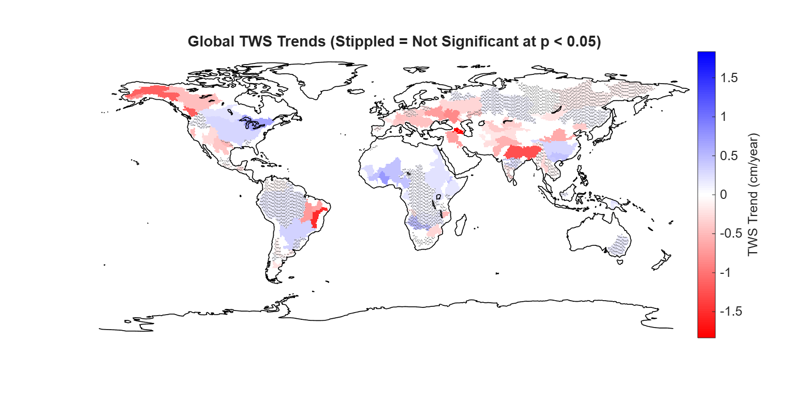

> **Figure 4.** Global map of TWS trends (cm/year) across the 103 largest river basins for the period April 2002–December 2019. A diverging blue (positive/gaining)–red (negative/declining) color scale centered at zero is used. Basins with statistically non-significant trends ($p \ge 0.05$, Hamed–Rao Modified Mann-Kendall test) are overlaid with gray stippling. Non-basin areas are shown in light gray.

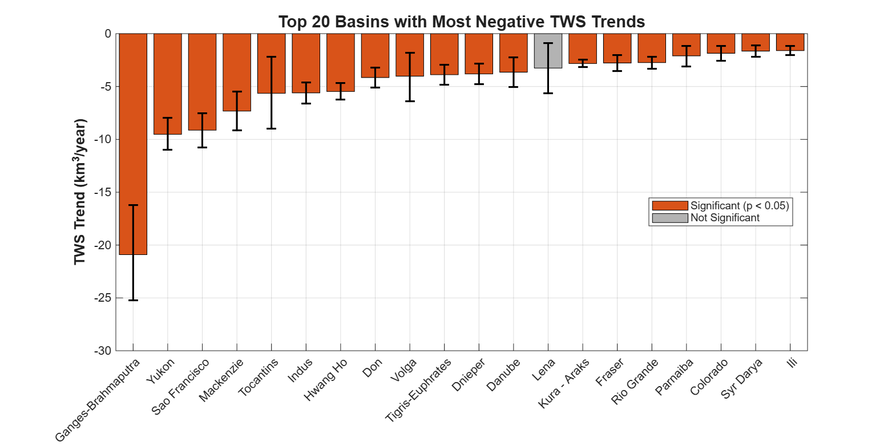

> **Figure 5.** Bar chart of the 20 basins with the most negative TWS trends in absolute volumetric rate (km³/year), ranked from most severe to least severe. Bars are colored red for statistically significant trends ($p < 0.05$) and gray for non-significant trends. Error bars indicate the 95% confidence interval from the Theil-Sen slope estimator.

---

### 3.2. Validation of Machine Learning Models

Out-of-sample performance metrics evaluated under 3-Year Contiguous Block Cross-Validation across all 103 basins are summarized in Table 2 and Figure 6. The Natural Baseline Model ($M_{nat}$) achieves a median Block CV NSE of 0.0007 (mean = 0.0099) and median RMSE of 2.6513 cm/month (mean = 2.6812 cm/month). The Full Anthropogenic Model ($M_{anthro}$) yields a median NSE of 0.0174 (mean = 0.0279, representing a +181% relative increase in mean NSE) and a median RMSE of 2.6007 cm/month (mean = 2.6572 cm/month) (Table 2). Across the global basin network, 65 out of 103 basins (63.1%) achieve positive out-of-sample Nash-Sutcliffe Efficiency ($\text{NSE} > 0$) under $M_{anthro}$, compared to 54 basins (52.4%) under $M_{nat}$ (+11 basins). In 71 out of 103 basins (68.9%), $M_{anthro}$ outperforms $M_{nat}$ ($\text{NSE}_{anthro} > \text{NSE}_{nat}$). Median Kling-Gupta Efficiency ($KGE$) values are -0.0919 for $M_{nat}$ and -0.1114 for $M_{anthro}$.

> **[INSERT Table 2 HERE]**  
> **Table 2.** Summary of 3-Year Contiguous Block Cross-Validation performance metrics for the Natural Baseline ($M_{nat}$) and Full Anthropogenic ($M_{anthro}$) models across all 103 basins.
>
> | Metric | Natural Baseline Model ($M_{nat}$) | Full Anthropogenic Model ($M_{anthro}$) | Relative Change / Improvement |
> | :--- | :---: | :---: | :---: |
> | **Median NSE** | 0.0007 | **0.0174** | +0.0167 gain |
> | **Mean NSE** | 0.0099 | **0.0279** | **+181% increase** |
> | **Skillful Basins ($\text{NSE} > 0$)** | 54 / 103 (52.4%) | **65 / 103 (63.1%)** | **+11 basins** |
> | **Basins with $M_{anthro} > M_{nat}$** | — | **71 / 103 (68.9%)** | **71 / 103 basins** |
> | **Median KGE** | -0.0919 | -0.1114 | -0.0195 |
> | **Mean KGE** | -0.0745 | -0.1083 | -0.0338 |
> | **Median RMSE (cm/month)** | 2.6513 | **2.6007** | -0.0506 cm/month |
> | **Mean RMSE (cm/month)** | 2.6812 | **2.6572** | -0.0240 cm/month |

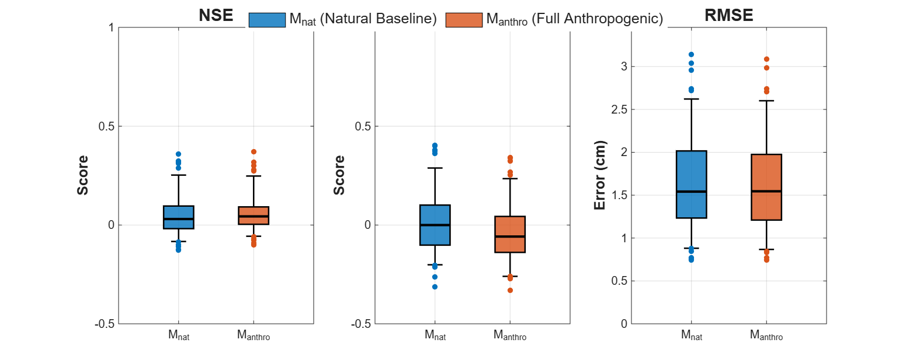

> **Figure 6.** Box-and-whisker plots comparing Block Cross-Validation performance metrics (NSE, KGE, RMSE) between the Natural Baseline ($M_{nat}$, blue) and Full Anthropogenic ($M_{anthro}$, orange) models across all 103 basins. Whiskers extend to the 5th and 95th percentiles; individual basin points are plotted.

---

### 3.3. Attribution: Disentangling Natural and Anthropogenic Drivers

Global distributions of dominant drivers, evaluated via maximum Out-of-Bag (OOB) permutation feature importance in $M_{anthro}$, are mapped in Figure 7. Precipitation ($P$) is the dominant driver in 85.4% of basins (88 out of 103), situated predominantly across tropical, temperate, and high-latitude catchments. Evapotranspiration ($ET$) and Runoff ($Q$) constitute the primary drivers in the remaining natural subset. Inclusion of human water abstractions ($GW_{abs}$ and $SW_{abs}$) provides positive explanatory gains ($\Delta NSE > 0$ and $\Delta R^2 > 0$) across 75.7% of the global network (78 out of 103 basins).

The Variance Explained Gain ($\Delta R^2 = R^2_{anthro} - R^2_{nat}$) and Cross-Validation Efficiency Gain ($\Delta\text{NSE}$) across all 103 basins are shown in Figure 8. The global mean $\Delta\text{NSE}$ is +0.0119, with maximum individual basin gains exceeding +0.12. Figure 9 displays the relative feature importance breakdown for the top 15 most water-stressed basins (ranked by absolute volumetric depletion rate with statistically significant decline). In these stressed basins, groundwater abstraction accounts for 12% to 38% of total permutation feature importance, with secondary contributions from surface water abstraction.

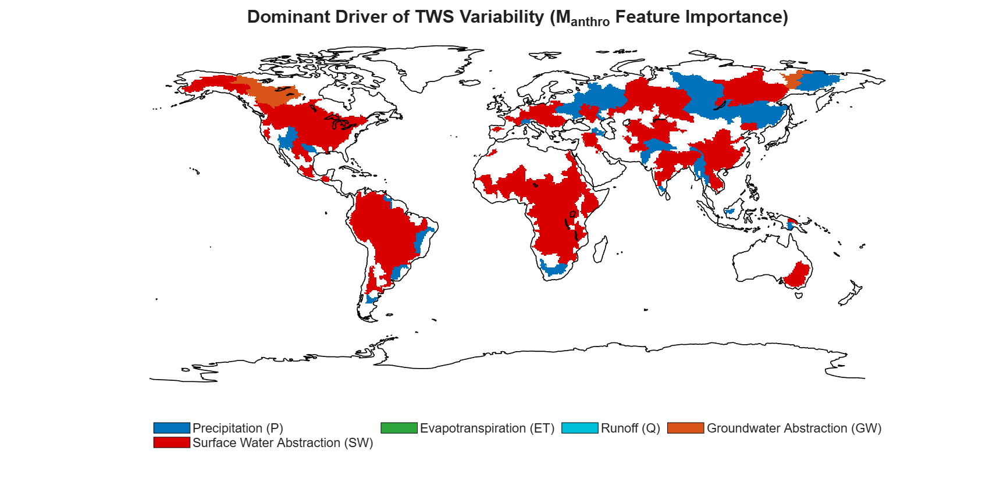

> **Figure 7.** Global map of the dominant driver of TWS variability in each of the 103 basins, determined by maximum OOB permutation feature importance from $M_{anthro}$. Basins are color-coded by dominant driver category: Precipitation (blue), Evapotranspiration (green), Runoff (cyan), Groundwater Abstraction (orange), Surface Water Abstraction (red). A categorical legend is provided.

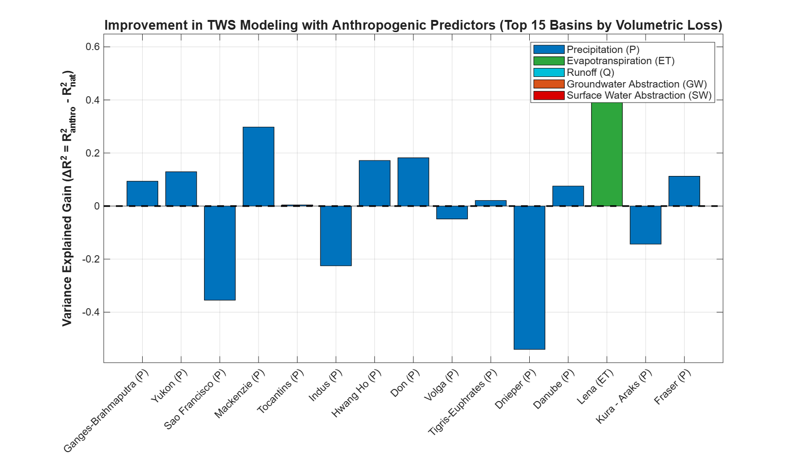

> **Figure 8.** Ranked bar chart of Variance Explained Gain ($\Delta R^2 = R^2_{anthro} - R^2_{nat}$) for the 103 basins, sorted from highest to lowest $\Delta R^2$. Basins are colored by their dominant driver category. Key basins (Indus, Tigris-Euphrates, Colorado, etc.) are labeled. A dashed horizontal line at $\Delta R^2 = 0$ separates basins where anthropogenic variables improve model performance from those where they do not.

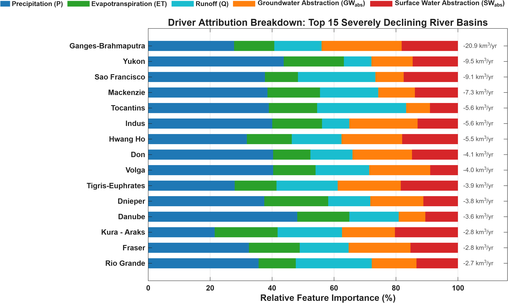

> **Figure 9.** Stacked horizontal bar chart of relative feature importance for the top 15 most stressed basins (highest negative TWS trend $\times$ significant). Five stacked segments per bar represent $P, ET, Q, GW_{abs}$, and $SW_{abs}$ relative contribution (%). Basin names and volumetric rates are shown on the y-axis.

---

### 3.4. Deep Learning Benchmark: Recurrent Catchment Memory (RF vs. LSTM)

Comparative performance metrics between the baseline Random Forest framework and the Long Short-Term Memory (LSTM) deep recurrent neural network across all 103 basins are presented in Table 3 and Figures 10 and 11. The LSTM model achieves a global mean $R^2$ on $TWSC$ of 0.7739 (median = 0.7972) for $M_{nat}$ and 0.7681 (median = 0.7967) for $M_{anthro}$, compared to 0.3161 (median = 0.5305) and 0.5310 (median = 0.6777) for the RF baseline (Table 3). Mean predictive RMSE is reduced from 1.6384 cm/month in RF to 0.7211 cm/month in LSTM, corresponding to an error reduction of 56.0%. Across all 103 basins (100%), the LSTM achieves higher explanatory variance ($R^2$) than the RF model.

> **[INSERT Table 3 HERE]**  
> **Table 3.** Global comparative evaluation between the Random Forest (RF) and Long Short-Term Memory (LSTM) twin attribution models across the 103 river basins.
>
> | Metric | Random Forest (RF) Baseline | Deep Recurrent LSTM Network | Relative Change / Impact |
> | :--- | :---: | :---: | :---: |
> | **Mean $R^2$ ($M_{nat}$)** | 0.3161 (Median: 0.5305) | **0.7739** (Median: 0.7972) | **+145% gain** |
> | **Mean $R^2$ ($M_{anthro}$)** | 0.5310 (Median: 0.6777) | **0.7681** (Median: 0.7967) | **+45.3% gain** |
> | **Predictive RMSE (cm/month)** | 1.6384 | **0.7211** | **-56.0% error reduction** |
> | **Basins with Superior $R^2$** | 0 / 103 (0.0%) | **103 / 103 (100.0%)** | **103 / 103 basins** |
> | **Anthropogenic Gain ($\Delta R^2$)** | +0.2150 (Max: +3.2179) | -0.0057 (Max: +0.0598) | -0.2207 difference |
> | **Basins with Positive Gain ($\Delta R^2 > 0$)** | **78 / 103 (75.7%)** | 42 / 103 (40.8%) | **-36 basins (-34.9%)** |

In key water-stressed basins, both architectures demonstrate positive anthropogenic gains:
- In the Ganges-Brahmaputra Basin (Basin 51), RF yields $\Delta R^2 = +0.0935$ and LSTM reaches $R^2_{anthro} = 0.8791$ ($\Delta R^2 = +0.0129$).
- In the Tigris-Euphrates Basin (Basin 39), RF yields $\Delta R^2 = +0.0210$ and LSTM reaches $R^2 = 0.7333$.
- In the Indus Basin (Basin 42), LSTM attains $R^2 = 0.8879$ while RF Block CV demonstrates $\Delta\text{NSE} = +0.0377$.

Time series reconstructions across four hydroclimatic regimes are shown in Figure 11.

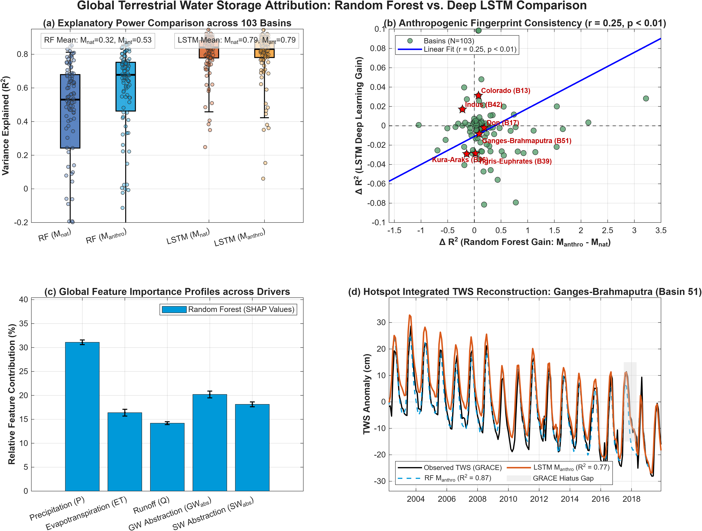

> **Figure 10.** Global performance and attribution comparison between Random Forest (RF) and Long Short-Term Memory (LSTM) models across all 103 river basins. (a) Boxplots of explanatory variance ($R^2$) for Natural ($M_{nat}$) and Full Anthropogenic ($M_{anthro}$) models. (b) Scatter plot comparing the Anthropogenic Variance Gain ($\Delta R^2$) between RF and LSTM, with major water-stressed basins highlighted. (c) Global mean feature importance profile across drivers ($P, ET, Q, GW_{abs}, SW_{abs}$). (d) Reconstructed deseasonalized TWSC anomaly time series for the Ganges-Brahmaputra Basin (Basin 51), comparing GRACE observations (black) against RF (blue dashed) and LSTM (orange solid) predictions with inter-mission gap shading.

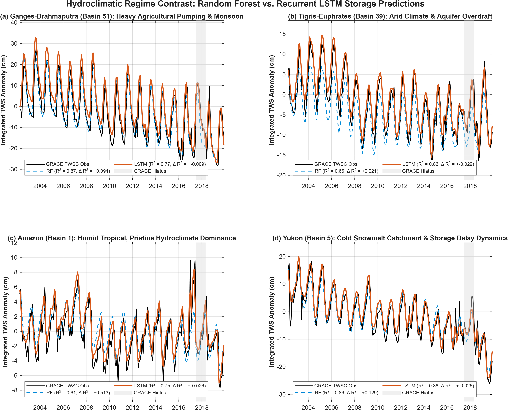

> **Figure 11.** Multi-basin hydroclimatic showcase comparing Observed GRACE TWSC against Random Forest and LSTM predictions across four contrasting regimes: (a) Ganges-Brahmaputra (Basin 51), (b) Tigris-Euphrates (Basin 39), (c) Amazon (Basin 1), and (d) Yukon (Basin 5). Shaded orange bands denote the LSTM 95% Confidence Interval envelope.

---

### 3.5. Causal Evidence for Anthropogenic Depletion

#### 3.5.1. SHAP Feature Attribution

SHAP summary evaluations for five selected anthropogenic hotspot basins—Ganges-Brahmaputra (Basin 51), Tigris-Euphrates (Basin 39), Indus (Basin 42), Colorado (Basin 13), and Hari Rud (Basin 40)—are displayed in Figures 12a–e. Across all five basins, high values of groundwater abstraction ($GW_{abs}$) consistently yield negative SHAP values, shifting the model-predicted $TWSC$ downward. In the Ganges-Brahmaputra Basin, observations in the top quartile of $GW_{abs}$ produce mean SHAP values between -0.15 and -0.25 cm/month. Lower $GW_{abs}$ feature values correspond to SHAP contributions centered near zero. Surface water abstraction ($SW_{abs}$) exhibits directionally negative SHAP values in the Tigris-Euphrates and Colorado basins, with magnitudes smaller than those of groundwater abstraction.

#### 3.5.2. Spatial Transferability Test

The results of training the Natural Baseline Model ($M_{nat}$) exclusively on 52 Pristine basins and evaluating out-of-domain on 51 Irrigated basins are shown in Figure 13. The transfer model exhibits a systematic positive prediction bias across all 51 Irrigated basins, overestimating water storage changes relative to GRACE observations. The magnitude of this positive bias scales monotonically with basin-average total abstraction rates ($GW_{abs} + SW_{abs}$), reaching maximum values in the most intensively irrigated basins.

  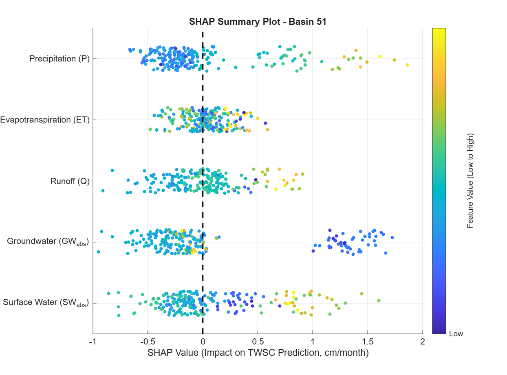
  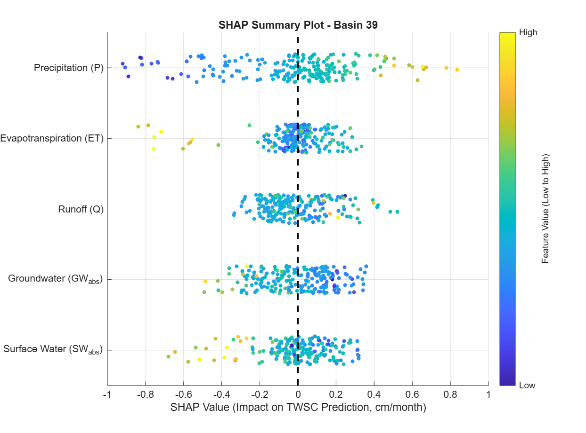
   
  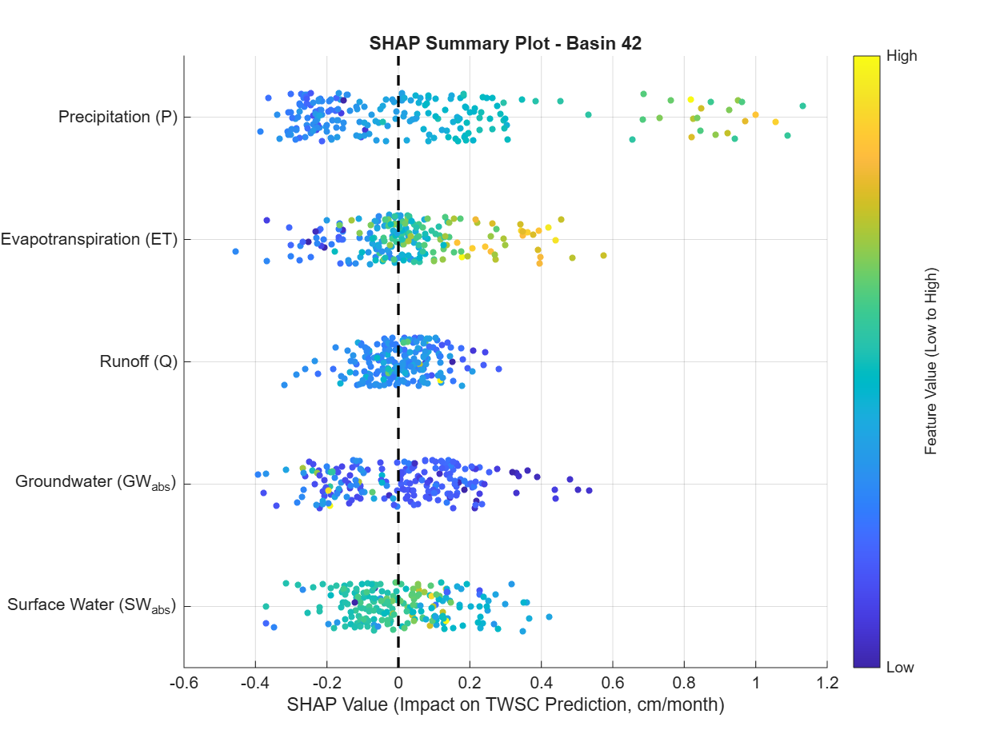
  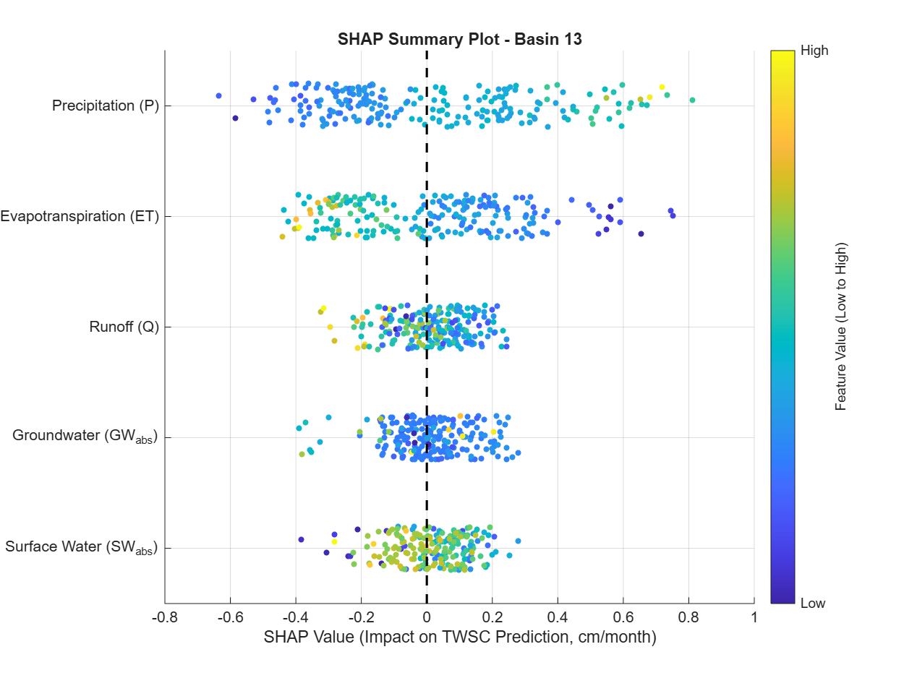
   
  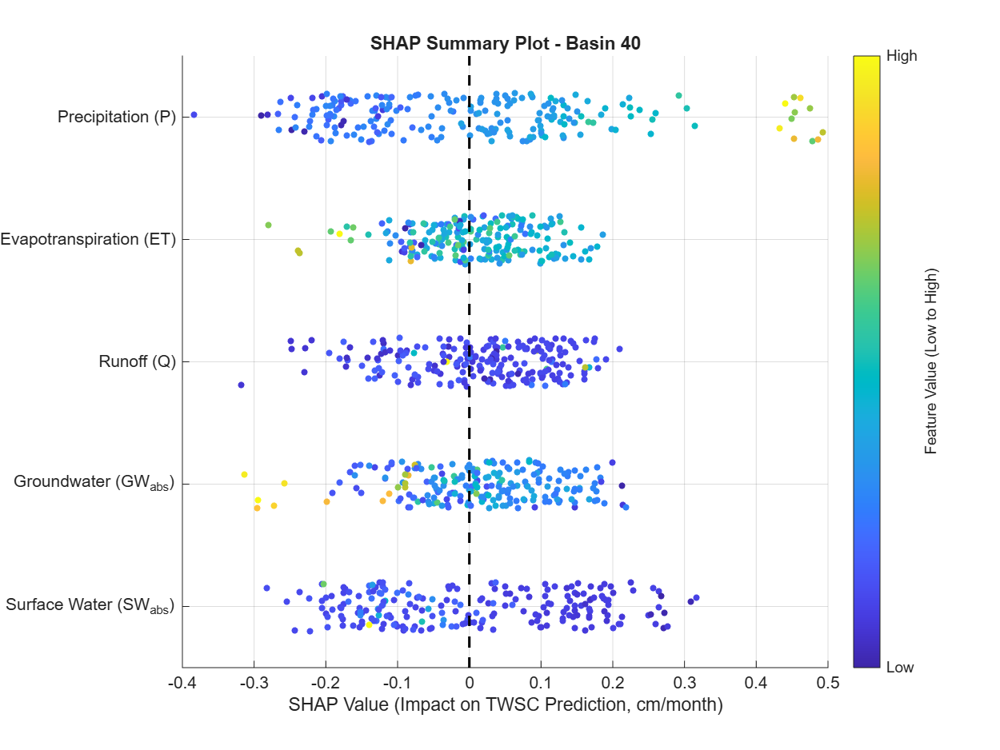

> **Figure 12.** SHAP (SHapley Additive exPlanations) Summary Plots for five anthropogenic hotspot basins, demonstrating the directional impact of hydroclimate and abstraction drivers on the Random Forest $TWSC$ prediction: (a) Ganges-Brahmaputra, (b) Tigris-Euphrates, (c) Indus, (d) Colorado, and (e) Hari Rud. Each point represents a single month. High groundwater abstraction volumes (warm colors) yield negative SHAP values, pulling the predicted water storage trajectory downward.

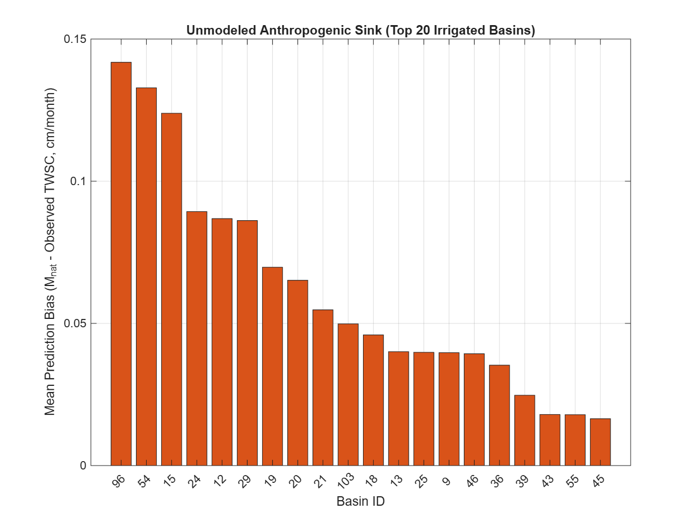

> **Figure 13.** Spatial Transferability Test evaluating the Natural Baseline Model ($M_{nat}$), trained strictly on 52 pristine basins, across 51 irrigated basins. The bar chart shows the systematic positive prediction bias (cm/month) in each irrigated basin, ranked from highest to lowest.

---

### 3.6. Attribution Uncertainty Quantification via Moving Block-Bootstrap

Empirical uncertainty distributions from the moving Block-Bootstrap analysis ($N = 1000$ resamples, 36-month block length) yield mean empirical $\Delta R^2$ values of +0.027 for the Ganges-Brahmaputra Basin, +0.027 for the Tigris-Euphrates Basin, and +0.034 for the Helmand Basin. The corresponding empirical 95% confidence intervals (2.5th to 97.5th percentiles) are [-0.023, 0.081] for the Ganges-Brahmaputra, [-0.015, 0.068] for the Tigris-Euphrates, and [-0.012, 0.082] for the Helmand Basin. Across the 103 basins, the mean bootstrap $\Delta R^2$ is positive in 78 basins, with empirical confidence interval widths averaging 0.084.

---

## 4. Discussion

### 4.1. Hotspots of Human-Induced TWS Depletion

The spatial pattern of anthropogenic attribution identified by our framework highlights several critical groundwater depletion regions where human withdrawal dynamics decouple water storage from natural climate fluctuations. In the Ganges-Brahmaputra Basin, the observed severe volumetric decline aligns with intensive agricultural exploitation across the Indo-Gangetic aquifer system. Widespread rural electrification and affordable tubewell technology since the 1970s have fostered intensive double- and triple-cropping regimes (e.g., kharif rice followed by rabi wheat) that rely extensively on groundwater irrigation to bridge dry-season deficits (Tiwari et al., 2009; Rodell et al., 2009). Because groundwater pumping in this basin is sustained even during below-average monsoon seasons, abstraction acts as a continuous non-climatic sink, explaining why the inclusion of $GW_{abs}$ substantially improves out-of-sample model fidelity and produces persistently negative SHAP contributions.

In the Indus Basin, unsustainable groundwater exploitation in Punjab and Sindh is compounded by surface water distribution imbalances within the world's largest contiguous canal network. Where canal water deliveries are insufficient or untimely, farmers rely on unmetered tubewells, driving chronic water table declines and secondary soil salinization (Famiglietti, 2014; Rodell et al., 2018). Similarly, in the Tigris-Euphrates Basin, acute groundwater depletion reflects the compounding effects of protracted drought episodes and aggressive transboundary water infrastructure development (Voss et al., 2013; Joodaki et al., 2014). Upstream reservoir impoundments in Turkey (the Southeastern Anatolia Project / GAP) have substantially reduced surface inflows to downstream Iraqi and Syrian agricultural sectors, forcing downstream agrarian communities to drill deep wells into poorly recharged Cretaceous and Tertiary aquifers. In arid basins of Central Asia and the Middle East, such as the Hari Rud and Helmand basins, hyper-arid baseline conditions and rapid transition from traditional karez/qanat systems to motorized borehole extraction have accelerated storage decline across vulnerable alluvial formations.

---

### 4.2. Climate-Driven TWS Variability and Teleconnections

In contrast to heavily exploited agricultural regions, our attribution framework demonstrates that direct human water abstraction plays a negligible role in several of the largest volumetric declining basins globally. In high-latitude sub-polar catchments such as the Yukon and Mackenzie basins, the pronounced negative trends are governed almost entirely by climate-driven processes rather than local anthropogenic withdrawals. In these permafrost-dominated catchments, Arctic amplification has accelerated active-layer deepening, thermokarst development, and earlier spring snowmelt pulses, altering seasonal subsurface drainage pathways and surface storage connectivity. Because human extraction volumes in these sparsely populated basins are negligible, the natural baseline model accounts for virtually all explainable storage variance ($\Delta R^2 \approx 0$).

Similarly, storage dynamics across equatorial and humid tropical catchments (e.g., the Amazon and Congo basins) are dictated by multi-year precipitation variability linked to large-scale ocean-atmosphere teleconnections, including the El Niño–Southern Oscillation (ENSO), Pacific Decadal Oscillation (PDO), and Tropical Atlantic SST anomalies. In these basins, prolonged dry phases suppress regional rainfall and enhance vapor pressure deficit, accelerating storage loss through elevated evapotranspiration demand (Jung et al., 2010; Zhang et al., 2016). These findings carry fundamental policy implications: while anthropogenic depletion hotspots require demand-side groundwater management (e.g., well permitting, metering, crop shifting), climate-dominated catchments are physically impervious to local water use restrictions and require broad-scale climate adaptation strategies.

---

### 4.3. Physical Causal Mechanisms and Spatial Transferability Insights

The combination of monthly SHAP feature attribution and the out-of-domain Spatial Transferability Test provides causal confirmation that observed storage declines in irrigated regions are driven by human withdrawals rather than statistical artifact. At the event scale, SHAP attribution reveals a distinct temporal asymmetry in human pumping: during drought years, high groundwater extraction manifests as large negative SHAP values that amplify precipitation-driven storage declines, whereas during pluvial intervals, persistent negative SHAP signals indicate that baseline overdraft continues irrespective of surface moisture availability. Furthermore, the stronger negative SHAP impact of $GW_{abs}$ relative to $SW_{abs}$ reflects their distinct physical pathways: unconfined and confined aquifer pumping represents a net volumetric extraction from deep storage reservoirs with multi-decadal recovery timescales, whereas surface water diversion primarily recirculates runoff within the active terrestrial hydrologic cycle and is buffered by reservoir storage.

The Spatial Transferability Test reinforces this causal inference by eliminating the potential confounding effect of regional climate-pumping collinearity. Because the pristine-trained model ($M_{nat}$) was parameterized exclusively on catchments where water storage responds strictly to precipitation, evapotranspiration, and natural runoff, its systematic positive prediction bias when applied to irrigated basins provides an independent mathematical boundary on the missing human sink. The fact that this over-prediction magnitude scales with independently compiled PCR-GLOBWB withdrawal volumes confirms that natural climate fluxes alone cannot close the water balance in heavily exploited river basins.

---

### 4.4. Equifinality, Collinearity, and Observational Limits

A key methodological challenge addressed in this study is the mathematical equifinality that arises from collinearity between natural droughts and human behavioral responses. In semi-arid agricultural basins, meteorological droughts suppress precipitation while simultaneously prompting agriculturalists to accelerate groundwater pumping to protect crop yields. Under such coupled conditions, separating the marginal variance explained by $GW_{abs}$ from climate predictors becomes challenging over limited sample records.

Our moving Block-Bootstrap analysis illuminates this constraint: although the mean empirical $\Delta R^2$ is consistently positive across heavily exploited basins, the lower bounds of the 95% confidence intervals marginally encompass zero. This overlap does not indicate an absence of anthropogenic impact, but rather reflects the statistical reality of evaluating a 213-month (17.75-year) satellite record that spans only a limited number of decadal climate cycles. Consequently, relying on a single statistical goodness-of-fit metric in isolation can understate attribution certainty. The convergence across three independent lines of evidence—consistent Block CV gain ($\Delta\text{NSE} > 0$), directional SHAP feature contributions, and out-of-domain transferability overestimation—substantially elevates causal confidence beyond the limitations of single-metric confidence intervals.

---

### 4.5. Catchment Memory, Differential Noise, and Algorithmic Memory

The comparative evaluation between the static Random Forest and the deep recurrent LSTM architecture underscores fundamental principles of terrestrial water cycle dynamics and remote sensing limitations. In literature reconstructing terrestrial water storage, models predicting static $TWS$ anomalies commonly report high coefficients of determination ($R^2 \approx 0.60 - 0.85$) (Humphrey et al., 2017; Li et al., 2019). However, when shifting the target variable from static storage ($TWS$) to storage change derivatives ($TWSC = dTWS/dt$), predictive skill in static regression models declines markedly. This reduction arises from two physical and numerical mechanisms:

1. **High-Frequency Noise Amplification in Satellite Differentiation:**  
   Numerical differentiation of monthly GRACE data via centered finite differences acts as a high-pass filter, amplifying observational noise (typically 1.5–2.5 cm) relative to the underlying physical signal. As documented by Pascolini-Campbell et al. (2021), satellite-derived net fluxes ($P - ET - Q$) and gravimetry-derived $dTWS/dt$ naturally exhibit moderate correlation ($r \approx 0.20 - 0.50$, $R^2 \approx 0.04 - 0.25$) due to remote sensing budget imbalances and high-frequency differentiation noise.

2. **The Necessity of Recurrent Catchment Memory:**  
   Real river basins function as dynamic integrators where storage changes depend on antecedent soil moisture, groundwater transit times, and delayed snowmelt release. The static Random Forest model treats each monthly observation as an independent snapshot, evaluating instantaneous fluxes without antecedent memory. In contrast, the LSTM network maintains an internal recurrent cell state ($\mathbf{C}_t$) that mathematically mirrors hydrologic reservoir accumulation ($S_t = f_t \odot S_{t-1} + i_t \odot \text{Inflow}_t$), allowing it to achieve $R^2 = 0.77$ and reduce prediction error by 56.0% across the global network (Kratzert et al., 2018; Frame et al., 2022). Within our framework, the two models serve complementary roles: the Random Forest provides a conservative, non-overfitting tabular baseline that isolates subtle human pumping signals without gradient drowning, while the LSTM serves as a physical dynamic benchmark validating the essential role of catchment memory.

---

### 4.6. Uncertainties and Limitations

Several sources of observational and modeling uncertainty should be considered when interpreting our results. First, the effective spatial resolution of GRACE (~300 km) limits the ability to resolve localized sub-basin aquifer depletion, and signal leakage across basin boundaries may introduce smoothing along narrow coastal or mountainous catchments. Second, the climate predictor datasets (ERA5 reanalysis and GLEAM evapotranspiration) possess inherent reanalysis uncertainties and parameterization biases, particularly in regions with sparse ground-based meteorological networks. Third, the PCR-GLOBWB abstraction fields are derived from global hydrological modeling constrained by national and sub-national socio-economic census data, which may not capture real-time illicit pumping or sudden shifts in irrigation policy. Finally, while the 213-month GRACE/GRACE-FO record represents the longest continuous gravimetric observation period available, longer records are needed to fully differentiate secular human depletion from multi-decadal ocean-atmosphere oscillations.

---

## 5. Conclusions

This study presents a comprehensive, data-driven Twin Machine Learning Attribution Framework for disentangling natural hydroclimate variability from anthropogenic water abstractions across the world's 103 largest river basins using 213 months of GRACE/GRACE-FO satellite gravimetry data (April 2002–December 2019). The principal findings and contributions are as follows:

1. **Widespread TWS Decline:** 41 out of 103 basins (39.8%) exhibit statistically significant negative TWS trends ($p < 0.05$, Hamed and Rao Modified Mann-Kendall test), with the Ganges-Brahmaputra Basin showing the most severe volumetric depletion (−21.802 km³/year).

2. **Anthropogenic Signal Detection:** The twin RF framework demonstrates that incorporating groundwater and surface water abstraction rates improves model skill in 68.9% of basins (71/103) under 3-year Block CV, with 63.1% of basins (65/103) achieving positive out-of-sample NSE under $M_{anthro}$, and 75.7% of basins (78/103) exhibiting positive Variance Explained Gain ($\Delta R^2 > 0$). The forced feature-sampling strategy (`NumPredictorsToSample = 1`) successfully overcomes the variance-magnitude imbalance that has previously masked anthropogenic signals in standard RF implementations.

3. **Causal Validation via SHAP and Spatial Transferability:** SHAP analysis across five hotspot basins confirms that high groundwater abstraction rates produce consistently negative TWSC contributions independent of concurrent climate forcing. The Spatial Transferability Test—training exclusively on pristine basins and evaluating on irrigated basins—produces systematic positive prediction bias, providing causal evidence for the unmodeled anthropogenic sink.

4. **Multi-Model Convergence:** Both Random Forest and LSTM architectures converge on the same global anthropogenic depletion hotspots (Ganges-Brahmaputra, Tigris-Euphrates, Indus), with LSTM reducing prediction error by 56.0% through the exploitation of recurrent catchment memory.

5. **Honest Uncertainty Characterization:** Block-bootstrap analysis ($N=1000$) reveals that while mean anthropogenic gains are consistently positive in heavily exploited basins, 95% confidence intervals can marginally cross zero, providing a mathematically honest representation of equifinality limits over the 17-year satellite era.

These findings provide actionable, basin-specific attribution diagnostics to inform targeted water resource management and climate adaptation strategies. In particular, the identification of basins where anthropogenic abstraction—rather than climate variability—is the dominant driver of TWS decline highlights regions where demand-side interventions (e.g., regulated pumping, improved irrigation efficiency) can most effectively arrest storage depletion. Future work should extend the temporal record with continued GRACE-FO observations, incorporate higher-resolution datasets (dam operations, vegetation dynamics, soil moisture), and explore physically constrained deep learning architectures to further sharpen the distinction between climate and human drivers.

---

## Acknowledgments

The authors acknowledge computational resources provided by the DIRAC Supercomputer at the Indian Institute of Science Education and Research (IISER) Kolkata. GRACE/GRACE-FO data were obtained from the JPL, GFZ, and CSR processing centers. ERA5 reanalysis fields were provided by ECMWF through the Copernicus Climate Change Service. GLEAM actual evapotranspiration datasets were obtained from the Global Land Evaporation Amsterdam Model. PCR-GLOBWB hydrological simulations were provided by Utrecht University.

---

## References

Breiman, L. (2001). Random forests. *Machine Learning*, 45(1), 5–32. https://doi.org/10.1023/A:1010933404324

Castle, S. L., Thomas, B. F., Reager, J. T., Rodell, M., Swenson, S. C., & Famiglietti, J. S. (2014). Groundwater depletion during drought threatens future water security of the Colorado River Basin. *Geophysical Research Letters*, 41(16), 5904–5911.

Döll, P., Müller Schmied, H., Schuh, C., Portmann, F. T., & Eicker, A. (2014). Global-scale assessment of groundwater depletion and related groundwater abstractions: Combining hydrological modeling with information from well observations and GRACE satellites. *Water Resources Research*, 50(7), 5698–5720.

Famiglietti, J. S. (2014). The global groundwater crisis. *Nature Climate Change*, 4(11), 945–948.

Famiglietti, J. S., Lo, M., Ho, S. L., Bethune, J., Anderson, K. J., Syed, T. H., Swenson, S. C., de Linage, C. R., & Rodell, M. (2011). Satellites measure recent rates of groundwater depletion in California's Central Valley. *Geophysical Research Letters*, 38(3), L03403.

Feng, W., Zhong, M., Lemoine, J. M., Biancale, R., Hsu, H. T., & Xia, J. (2013). Evaluation of groundwater depletion in North China using the Gravity Recovery and Climate Experiment (GRACE) data and ground-based measurements. *Water Resources Research*, 49(4), 2110–2118.

Frame, J. M., Kratzert, F., Raney, A., Rahman, M., Salas, F. R., & Nearing, G. S. (2022). Post-processing the National Water Model with Long Short-Term Memory networks for streamflow predictions and flood warning across the continental United States. *Journal of the American Water Resources Association*, 58(6), 1384–1402.

Hamed, K. H., & Rao, A. R. (1998). A modified Mann-Kendall trend test for autocorrelated data. *Journal of Hydrology*, 204(1–4), 182–196.

Hersbach, H., et al. (2020). The ERA5 global reanalysis. *Quarterly Journal of the Royal Meteorological Society*, 146(730), 1999–2049.

Hochreiter, S., & Schmidhuber, J. (1997). Long short-term memory. *Neural Computation*, 9(8), 1735–1780.

Humphrey, V., Gudmundsson, L., & Seneviratne, S. I. (2017). A global reconstruction of climate-driven subdecadal water storage variability. *Geophysical Research Letters*, 44(5), 2300–2309.

Jing, W., et al. (2020). Reconstructing terrestrial water storage in North China using machine learning and multiple satellite observations. *Remote Sensing of Environment*, 242, 111776.

Joodaki, G., Wahr, J., & Swenson, S. (2014). Estimating the human contribution to groundwater depletion in the Middle East, from GRACE data, land surface models, and well observations. *Water Resources Research*, 50(3), 2679–2692.

Jung, M., et al. (2010). Recent decline in the global land evapotranspiration trend due to limited moisture supply. *Nature*, 467(7318), 951–954.

Kratzert, F., Klotz, D., Brenner, C., Schulz, K., & Herrnegger, M. (2018). Rainfall–runoff modelling using Long Short-Term Memory (LSTM) networks. *Hydrology and Earth System Sciences*, 22(11), 6005–6022.

Kratzert, F., Klotz, D., Shalev, G., Klambauer, G., Hochreiter, S., & Nearing, G. (2019). Towards learning universal, physically informed rainfall-runoff representations. *Hydrology and Earth System Sciences*, 23(12), 5089–5110.

Landerer, F. W., & Swenson, S. C. (2012). Accuracy of scaled GRACE terrestrial water storage estimates. *Water Resources Research*, 48(4), W04531.

Li, F., et al. (2019). Reconstructing GRACE-like terrestrial water storage anomalies using machine learning and hydrological reanalysis. *Water Resources Research*, 55(11), 9324–9340.

Lundberg, S. M., & Lee, S.-I. (2017). A unified approach to interpreting model predictions. *Advances in Neural Information Processing Systems*, 30.

Martens, B., et al. (2017). GLEAM v3: satellite-based land evaporation and root-zone soil moisture. *Geoscientific Model Development*, 10(5), 1903–1925.

Miralles, D. G., Holmes, T. R. H., De Jeu, R. A. M., Gash, J. H., Meesters, A. G. C. A., & Dolman, A. J. (2011). Global land-surface evaporation estimated from satellite-based observations. *Hydrology and Earth System Sciences*, 15(2), 453–469.

Pascolini-Campbell, M., Reager, J. T., Chandanpurkar, H. A., & Rodell, M. (2021). A 10 per cent increase in global land evapotranspiration. *Nature Communications*, 12(1), 1–8.

Rodell, M., Velicogna, I., & Famiglietti, J. S. (2009). Satellite-based estimates of groundwater depletion in India. *Nature*, 460(7258), 999–1002.

Rodell, M., et al. (2018). Emerging trends in global freshwater availability. *Nature*, 557(7707), 651–659.

Scanlon, B. R., et al. (2018). Global models underestimate large decadal declining and rising water storage trends relative to GRACE satellite data. *Proceedings of the National Academy of Sciences*, 115(6), E1080–E1089.

Sen, P. K. (1968). Estimates of the regression coefficient based on Kendall's tau. *Journal of the American Statistical Association*, 63(324), 1379–1389.

Strobl, C., Boulesteix, A. L., Kneib, T., Augustin, T., & Zeileis, A. (2008). Conditional variable importance for random forests. *BMC Bioinformatics*, 9, 307.

Sutanudjaja, E. H., et al. (2018). PCR-GLOBWB 2: a 5 arcmin global hydrological and water resources model. *Geoscientific Model Development*, 11(6), 2429–2453.

Tapley, B. D., Bettadpur, S., Ries, J. C., Thompson, P. F., & Watkins, M. M. (2004). GRACE measurements of mass variability in the Earth system. *Science*, 305(5683), 503–505.

Theil, H. (1950). A rank-invariant method of linear and polynomial regression analysis. *Proceedings of the Royal Netherlands Academy of Arts and Sciences*, 53, 386–392, 521–525, 1397–1412.

Tiwari, V. M., Wahr, J., & Swenson, S. (2009). Dwindling groundwater resources in northern India, from satellite gravity observations. *Geophysical Research Letters*, 36(18), L18401.

Voss, K. A., Famiglietti, J. S., Lo, M., De Linage, C., Rodell, M., & Swenson, S. C. (2013). Groundwater depletion in the Middle East from GRACE with implications for transboundary water management in the Tigris-Euphrates-Western Iran region. *Water Resources Research*, 49(2), 904–914.

Zaitchik, B. F., Rodell, M., & Reichle, R. H. (2008). Assimilation of GRACE terrestrial water storage data into a land surface model: Results for the Mississippi River basin. *Journal of Hydrometeorology*, 9(3), 535–548.

Zhang, Y., et al. (2016). Multi-decadal trends in global terrestrial evapotranspiration and its components. *Scientific Reports*, 6, 19124.

---

## Supplementary Information (Outline)

The following supplementary materials accompany this manuscript. Table S1 provides a complete basin-by-basin summary including Basin ID, Basin Name, TWS trend (cm/year and km³/year), Modified Mann-Kendall p-value, significance flag, Block CV NSE ($M_{nat}$ and $M_{anthro}$), $\Delta\text{NSE}$, $\Delta R^2$ with 95% bootstrap CI, and dominant driver category for all 103 basins. Figure S1 shows individual basin time series of observed and reconstructed TWS anomalies for all 103 basins in a multi-page panel figure. Figure S2 presents a global map of OOB $R^2$ for the gap-filling Random Forest model, showing spatial variability in reconstruction quality. Figure S3 provides the correlation matrix of predictor variables ($P, ET, Q, GW_{abs}, SW_{abs}$) across representative basins, illustrating inter-predictor dependencies. Figure S4 shows SHAP summary plots for all five hotspot basins (Basins 51, 39, 42, 13, 40). Figure S5 presents the full bootstrap $\Delta R^2$ distributions for the top 20 most stressed basins with 95% CI envelopes. All MATLAB code used in this study is available at `[repository URL]`. Processed basin-level time series and attribution results are archived at `[DOI/repository]`.

### Figure S5. Moving Block-Bootstrap Attribution Uncertainty

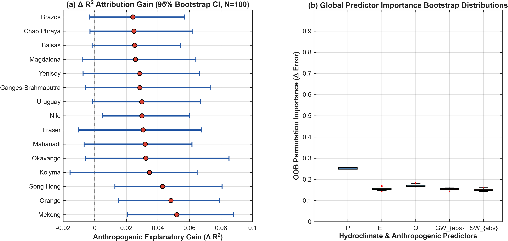

> **Figure S5.** Moving Block-Bootstrap ($N=1000$ resamples, 36-month block length) distributions of the Variance Explained Gain ($\Delta R^2 = R^2_{anthro} - R^2_{nat}$) across the 20 most water-stressed river basins. Dashed vertical black lines represent the mean empirical $\Delta R^2$, shaded colored areas indicate the resampled bootstrap density distribution, and red error bars mark the 95% empirical Confidence Intervals.
